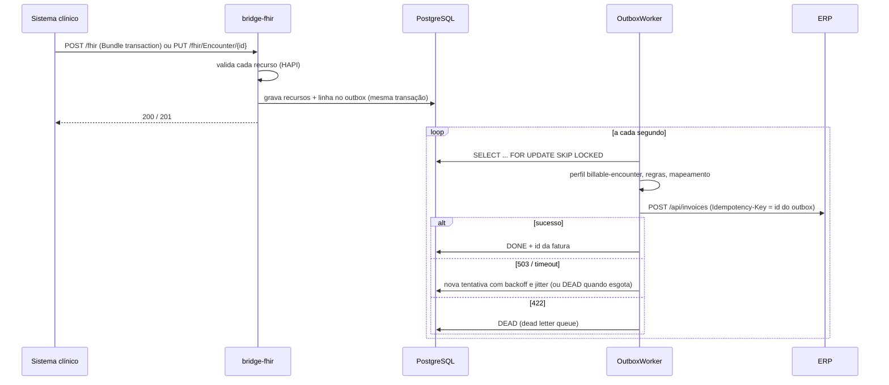

# Health Data Bridge

Ponte entre uma API **FHIR R4** e um **ERP**. Quando um atendimento (`Encounter`) é finalizado, o ERP emite a fatura; quando o cadastro de operadoras e unidades muda no ERP, o lado FHIR acompanha. Toda entrega é idempotente, auditável e sobrevive a falhas do ERP: outbox transacional, `Idempotency-Key`, retry com backoff e jitter, circuit breaker, dead letter queue e reconciliação diária.

**Stack:** Java 21 · Spring Boot 3.5 · Maven multi-módulo · HAPI FHIR 8.10 (R4) · PostgreSQL 16 · Flyway · Resilience4j · MapStruct · Micrometer/Prometheus · JUnit 5 + Mockito + AssertJ + Testcontainers + WireMock · Docker Compose · GitHub Actions.

> **Projeto de demonstração, com dados fictícios.** Nenhum dado real de paciente é usado em nenhum lugar. Os CPFs são gerados com dígito verificador válido a partir de uma semente fixa; os nomes são combinações de nomes comuns; operadoras, unidades e o hospital são inventados.

## Subir

```bash
docker compose up --build
# FHIR:     http://localhost:8080/fhir/metadata
# admin:    http://localhost:8080/admin/outbox?status=DEAD
# métricas: http://localhost:8080/actuator/prometheus
# ERP mock: http://localhost:8090/openapi.yaml
```

O seed carrega 20 pacientes e 50 encontros finalizados (de 2026-10-01 a 2026-10-05), um `Bundle` de transação por encontro. Em poucos segundos o worker entrega tudo, e o ERP fica com 51 faturas: as 50 e uma **divergência plantada** de propósito (`enc-planted`, em 2026-10-03), que a reconciliação tem que achar.

O caminho de aceite inteiro está em `scripts/smoke.py` (só biblioteca padrão), que o workflow `compose` roda contra o Compose:

```bash
python3 -I scripts/smoke.py http://localhost:8080 http://localhost:8090
```

### Sem Docker

Precisa de JDK 21, Maven e um PostgreSQL.

```bash
mvn -DskipTests package
ERP_PORT=8090 java -jar erp-mock/target/erp-mock-0.1.0-SNAPSHOT-exec.jar &
HDB_DB_URL=jdbc:postgresql://localhost:5432/hdb HDB_DB_USER=... HDB_DB_PASSWORD=... \
  ERP_BASE_URL=http://localhost:8090 HDB_SEED_ENABLED=true \
  java -jar bridge-app/target/bridge-app-0.1.0-SNAPSHOT.jar
```

## Arquitetura

```
health-data-bridge/
├── bridge-core/          regras de faturamento, extração FHIR → fatura, MapStruct, CPF, dados fictícios
├── bridge-fhir/          RestfulServer do HAPI, store em PostgreSQL (jsonb + índice), Bundle transaction, perfil
├── bridge-sync/          outbox, worker, ErpClient, circuit breaker, DLQ, sync de cadastros, reconciliação
├── bridge-app/           aplicação Spring Boot, seed, testes ponta a ponta e de caos
├── erp-mock/             ERP simulado com OpenAPI e falhas injetáveis
└── bridge-test-support/  banco de teste (Testcontainers ou URL), erp-mock na mesma JVM
```



### Fluxo principal: encontro finalizado vira fatura

1. O `Encounter` com `status = finished` é gravado, e o `OutboxEnqueuer` insere `CREATE_INVOICE` **na mesma transação**. Salvar o mesmo encontro de novo não cria outro evento (constraint única).
2. O `OutboxWorker` reivindica um lote com `FOR UPDATE SKIP LOCKED`, então várias instâncias ou threads dividem o trabalho sem coordenação.
3. Para cada linha: valida o `Encounter` contra o perfil próprio [`billable-encounter`](bridge-fhir/src/main/resources/profiles/billable-encounter.json), busca `Patient`, `Condition`, `Claim` e `Coverage`, aplica as regras de faturamento e mapeia para o contrato do ERP. O paciente vai para o ERP **só como referência** (`Patient/pat-01`), nunca nome ou CPF.
4. Envia com `Idempotency-Key` = id da linha. Sucesso vira `DONE`; 503 ou timeout vira retry com backoff exponencial e jitter; 422 ou tentativas esgotadas vira `DEAD`.
5. O circuit breaker abre com 50% de falhas numa janela de 20 chamadas e fica 30 s aberto. Aberto, o worker não reivindica nada: o outbox cresce e nenhuma tentativa é gasta. 422 não conta como falha do ERP.

### Fluxo reverso: cadastros do ERP alimentam o FHIR

A cada 15 minutos, clientes do ERP viram `Organization` e locais viram `Location`, com update condicional por `identifier` (o código do ERP). O cursor por entidade anda na mesma transação de cada registro, e registro que não mudaria o recurso é pulado para não subir versão à toa.

### Reconciliação

Todo dia às 02:00 UTC (ou `POST /admin/reconciliation/run?date=2026-10-03`), os encontros finalizados de um dia são comparados com as faturas do ERP daquele dia. Divergências (`MISSING_INVOICE`, `DUPLICATE_INVOICE`, `ORPHAN_INVOICE`) ficam em `reconciliation_issue`, com o motivo: para fatura faltando, o estado do outbox (na DLQ e por quê, pendente, nunca enfileirado).

## API

| | |
|---|---|
| `GET /fhir/metadata` | `CapabilityStatement` |
| `GET/POST/PUT /fhir/{Patient,Encounter,Coverage,Claim,Condition,Organization,Location,Practitioner}` | read, create, update, update condicional `?identifier=system\|value`, `If-Match` |
| `GET /fhir/Patient?identifier=`, `Encounter?patient=&date=&status=`, `Claim?status=&encounter=` | buscas com `_count` e links `next` |
| `POST /fhir` | `Bundle` do tipo `transaction`, atômico |
| `GET /admin/outbox?status=DEAD` | dead letter queue |
| `POST /admin/outbox/{id}/retry` | devolve uma linha `DEAD` para a fila, com a mesma `Idempotency-Key` |
| `POST /admin/reconciliation/run?date=` · `GET /admin/reconciliation?date=` | reconciliação de um dia |
| `POST /admin/registry/sync` | sincroniza cadastros do ERP agora |
| `GET /actuator/prometheus` | `bridge_outbox_pending`, `bridge_outbox_dead`, `bridge_outbox_oldest_pending_age_seconds`, `bridge_outbox_deadlettered_total`, `resilience4j_circuitbreaker_state`... |

Recurso inválido não é gravado: a resposta é `422` com `OperationOutcome`. Num `Bundle`, uma entrada inválida desfaz a transação inteira, e o `OperationOutcome` aponta `Bundle.entry[i]`.

O contrato do ERP está em [`erp-mock/src/main/resources/static/openapi.yaml`](erp-mock/src/main/resources/static/openapi.yaml). Falhas do mock: `PUT /admin/faults/invoices` com `{"latencyMs":…, "errorRate":…, "permanentErrorRate":…, "failAfterCommitRate":…, "down":…}`.

## Testes

```bash
mvn verify   # Testcontainers sobe o PostgreSQL; sem Docker, use HDB_TEST_JDBC_URL
HDB_TEST_JDBC_URL=jdbc:postgresql://localhost:5432/hdb_test HDB_TEST_DB_USER=postgres mvn verify
```

Sem banco nenhum, as classes de integração aparecem como **skipped**, nunca como aprovadas, e o workflow `java` falha se alguma for pulada. Os testes rodam no fuso `America/Sao_Paulo` de propósito: todo dia de faturamento é UTC, e um vazamento do fuso da JVM aparece como dia errado.

| O quê | Como |
|---|---|
| Regras, extração, mapeamento, CPF, retry, decisão do breaker | unitários; o breaker com `Clock` injetado, sem esperar 30 s |
| FHIR: perfil, recurso inválido, `CapabilityStatement`, buscas, paginação, `Bundle` atômico, `If-Match` | `FhirServerIT`, `ResourceValidatorTest` |
| Contrato com o ERP | `ErpClientContractTest`: a requisição que a ponte envia é validada contra o `openapi.yaml`, mais um corpo golden; o `erp-mock` valida as próprias respostas contra o mesmo arquivo |
| Outbox | `OutboxIT`: entrega, retry, DLQ e reprocessamento, dois workers concorrentes sem nenhum envio repetido, breaker pausando sem gastar tentativa |
| Ponta a ponta | `EndToEndIT` com o `erp-mock` real na mesma JVM |
| Caos | `ChaosIT`: 1000 encontros por HTTP, 20% de 503, 10% de resposta perdida depois do commit, duas quedas totais de 4 s, dois workers |
| Logs sem dado de paciente | `PatientDataNotLoggedIT` procura CPF (puro e formatado) e nome de cada paciente na saída; o workflow `compose` procura qualquer coisa com formato de CPF no log do container |

### Números medidos

Medidos em 2026-10-20, WSL2, JDK 21.0.12, PostgreSQL 18.6 local via `HDB_TEST_JDBC_URL` (esta máquina não tem Docker), com `mvn clean verify`:

- **103 testes, 0 pulados**, build completo em 148 s.
- **Cobertura de linhas (JaCoCo, unitários + integração):** `bridge-core` 99,0% (302/305), `bridge-sync` 92,8% (462/498), `bridge-fhir` 89,1%, `erp-mock` 95,8%. O gate de 75% vale para `bridge-core` e `bridge-sync`.
- **Teste de caos** (`bridge-app/target/chaos-report.txt`): 1000 encontros em 44 s; 1094 requisições chegaram ao ERP e 378 falhas foram injetadas; 94 respostas perdidas depois do commit, todas recuperadas por replay da `Idempotency-Key`. Resultado: **1000 faturas, 1000 encontros distintos, zero duplicatas, DLQ vazia**, no máximo 5 tentativas para um mesmo evento.

`scripts/smoke.py` passou inteiro contra os dois jars rodando localmente com o seed. **O `docker compose up` em si não foi executado aqui** (sem Docker); quem verifica as imagens e o Compose é o workflow `compose` no GitHub Actions.

## Decisões

| ADR | |
|---|---|
| [001](docs/adr/001-hapi-fhir-com-fachada-propria.md) | HAPI FHIR, com fachada própria em vez do JPA Server |
| [002](docs/adr/002-outbox-transacional.md) | Outbox transacional em vez de chamar o ERP na requisição |
| [003](docs/adr/003-idempotencia-nas-duas-pontas.md) | Idempotência nas duas pontas |
| [004](docs/adr/004-reconciliacao-diaria.md) | Reconciliação diária além do retry |
| [005](docs/adr/005-erp-simulado.md) | ERP simulado em serviço separado |
| [006](docs/adr/006-jdbc-em-vez-de-jpa.md) | JdbcTemplate em vez de Spring Data JPA |

A especificação completa está em [`docs/prd.md`](docs/prd.md); a seção 0 registra as decisões tomadas antes de codar.

## Segurança e conformidade

- Dados fictícios, sempre. Não use dado real de paciente em fixture, seed ou issue.
- Nome e CPF não saem do armazenamento FHIR: o ERP recebe a referência `Patient/{id}`, os logs carregam ids de outbox e de encontro, e o corpo de erro do ERP é reduzido ao código antes de virar log.
- **Sem autenticação na v1.** Os endpoints `/fhir` e `/admin` estão abertos; isto é uma demonstração, não um serviço para expor. O próximo passo é **SMART on FHIR** (OAuth2 com escopos por recurso, como `patient/Encounter.read`) no `/fhir`, e credencial de serviço separada para o `/admin`.

## Fora do escopo da v1

- SMART on FHIR e OAuth2 de produção.
- Padrões brasileiros como **RNDS** e **TISS**, que são o próximo passo natural para o mercado nacional.
- ERP real (Protheus, SAP): trocar o `erp-mock` exige o contrato daquele ERP.
- Histórico de versões (`vread`), `_include`, delete.
